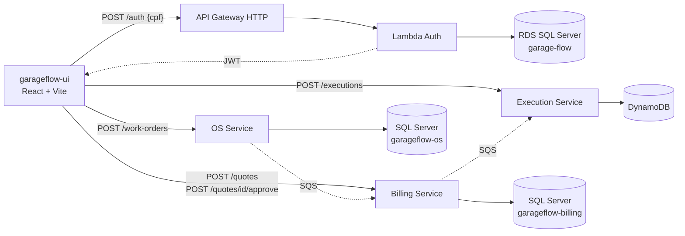

# GarageFlow UI

Interface web (React + TypeScript + Vite) para demonstrar o fluxo da ordem de serviço (OS) da solução de microsserviços do GarageFlow: login por CPF, abertura da OS, orçamento, aprovação de pagamento e envio para execução.

Projeto do Tech Challenge Fase 4 (FIAP Pós Tech). Repositório: `https://github.com/FiapPosEAA/garageflow-ui`.

## Sumário

- [Visão geral da solução](#visão-geral-da-solução)
- [Telas e funcionalidades](#telas-e-funcionalidades)
- [Autenticação e endpoints consumidos](#autenticação-e-endpoints-consumidos)
- [Estrutura do projeto](#estrutura-do-projeto)
- [Stack e scripts](#stack-e-scripts)
- [Configuração](#configuração)
- [Execução local](#execução-local)
- [Build e implantação](#build-e-implantação)
- [Testes e qualidade](#testes-e-qualidade)
- [CI/CD](#cicd)
- [Status e pendências](#status-e-pendências)
- [Troubleshooting](#troubleshooting)

## Visão geral da solução



As setas tracejadas entre serviços representam a mensageria (SQS) planejada para a Saga; hoje os serviços apenas publicam eventos (OS e Billing) e nenhum os consome. A UI chama cada serviço diretamente, de forma sequencial.

| Repositório | Papel |
|---|---|
| `garageflow-ui` (este) | Interface de demonstração |
| `fiap-garageflow-lambda-auth` | `POST /auth`: CPF → JWT |
| `garageflow-os-service` | `POST /work-orders` (e `GET /work-orders/{id}`) |
| `garageflow-billing-service` | `POST /quotes` (e `GET /quotes/{id}`) |
| `garageflow-execution-service` | `POST /executions` (e `GET /executions/{id}`) |
| `fiap-garageflow-api` | Monólito legado/referência de domínio |
| `fiap-garageflow-db-infra` / `fiap-garageflow-k8s-infra` | RDS SQL Server; VPC e EKS |

## Telas e funcionalidades

Tudo está em uma única página (`src/App.tsx`), sem roteamento:

1. **Recepção (login):** campo de CPF e botão "Entrar no atendimento". Sem o JWT, só esta tela é exibida.
2. **Barra do cliente autenticado:** mostra o nome retornado pela autenticação e o botão "Trocar cliente" (limpa o token e o nome).
3. **01 · Abrir ficha do veículo:** campos "ID do cliente" (preenchido com o `customer.id` retornado no login, editável) e "Placa / veículo" (enviado como `vehicleId`, texto livre). Cria a OS.
4. **02 · Painel do serviço:** linha do tempo com quatro etapas: Recepção, Orçamento, Aprovação e Box de reparo.
5. **Ações:** "Montar orçamento" (Billing), "Aprovar pagamento" (Billing) e "Liberar para o mecânico" (Execution). Cada botão só é habilitado após a etapa anterior.
6. **Mensagens de status/erro** em uma faixa de aviso; o corpo da resposta de erro HTTP é exibido.

Observações sobre o comportamento atual:

- O valor do orçamento é fixo: o estado `amount` inicia em `250` e não há campo de edição na tela.
- Não há listagem de OS nem consulta (`GET`) a nenhum serviço; a tela guarda em memória apenas a OS, o orçamento e a execução da sessão atual.
- O token fica somente em estado React (memória); recarregar a página exige novo login.
- O rótulo "Checkout · Mercado Pago" é apenas visual: a UI não integra com o Mercado Pago.

## Autenticação e endpoints consumidos

**Login (CPF → JWT).** A UI faz `POST {VITE_AUTH_API_URL}/auth` com `{ "cpf": "<digitado>" }`. Pelo código da Lambda, ela normaliza e valida o CPF, procura o cliente ativo na tabela `customers` e responde `{ token: "Bearer <jwt>", expiresAt, customer: { id, name, document } }` (validade de 8 h). A UI guarda o token e envia `Authorization: Bearer <jwt>` nas demais chamadas (o prefixo `Bearer ` não é duplicado).

| Etapa na UI | Requisição | Corpo | Situação no serviço |
|---|---|---|---|
| Login | `POST {VITE_AUTH_API_URL}/auth` | `{ cpf }` | Existe (Lambda + API Gateway) |
| Dar entrada | `POST {VITE_OS_API_URL}/work-orders` | `{ customerId, vehicleId }` | Existe (OS Service) |
| Montar orçamento | `POST {VITE_BILLING_API_URL}/quotes` | `{ workOrderId, amount }` | Existe (Billing) |
| Aprovar pagamento | `POST {VITE_BILLING_API_URL}/quotes/{id}/approve` | — | **Não existe** no Billing Service atual (apenas `POST /quotes` e `GET /quotes/{id}`) |
| Liberar para o mecânico | `POST {VITE_EXECUTION_API_URL}/executions` | `{ workOrderId }` | Existe (Execution) |

Todos os serviços exigem JWT (`[Authorize]`) e validam emissor e audiência. Em cada serviço o CORS aceita a origem definida em `Frontend:Origin` (padrão `http://localhost:5173`).

## Estrutura do projeto

```text
garageflow-ui/
├── index.html              # entrada Vite (lang pt-BR)
├── package.json            # scripts e dependências
├── package-lock.json
├── vite.config.ts          # plugin React, porta 5173
├── tsconfig.json
├── tsconfig.app.json       # strict, noEmit, jsx react-jsx
├── tsconfig.node.json
└── src/
    ├── main.tsx            # monta <App /> em StrictMode
    ├── App.tsx             # login, fluxo da OS e chamadas HTTP
    ├── styles.css
    └── vite-env.d.ts
```

Também existem na pasta `vite.config.js`, `vite.config.d.ts` e arquivos `*.tsbuildinfo`, que parecem artefatos gerados pelo TypeScript; não estão no `.gitignore` (que cobre `node_modules/`, `dist/`, `.env` e `.env.local`).

## Stack e scripts

- React 18.3, React DOM 18.3
- TypeScript 5.7 (`strict`), Vite 6, `@vitejs/plugin-react` 4.3
- Sem biblioteca de rotas, de estado, de testes ou de lint

| Script | Comando | Descrição |
|---|---|---|
| `npm run dev` | `vite` | Servidor de desenvolvimento em `http://localhost:5173` |
| `npm run build` | `tsc -b && vite build` | Verificação de tipos e build em `dist/` |
| `npm run preview` | `vite preview` | Serve o `dist/` localmente (porta padrão do Vite) |

Node.js: o `package.json` não define `engines`; use uma versão suportada pelo Vite 6 (Node 18 ou superior; Node 20+ recomendado).

## Configuração

Variáveis lidas por `import.meta.env` em `src/App.tsx`. Em Vite, variáveis `VITE_*` são embutidas no bundle e ficam visíveis no navegador: **nunca** coloque segredos nelas.

| Variável | Obrigatória | Padrão no código | Descrição |
|---|:---:|---|---|
| `VITE_AUTH_API_URL` | Sim (para login) | vazio | URL base do API Gateway da Lambda Auth (saída `api_gateway_url` do Terraform), sem `/auth` no final |
| `VITE_OS_API_URL` | Não | `http://localhost:5001` | URL base do OS Service |
| `VITE_BILLING_API_URL` | Não | `http://localhost:5002` | URL base do Billing Service |
| `VITE_EXECUTION_API_URL` | Não | `http://localhost:5003` | URL base do Execution Service |

Sem `VITE_AUTH_API_URL`, o login exibe "Configure VITE_AUTH_API_URL com a URL do API Gateway.". Defina os valores em `.env.local` (ignorado pelo Git):

```text
VITE_AUTH_API_URL=<url-do-api-gateway>
VITE_OS_API_URL=http://localhost:5001
VITE_BILLING_API_URL=http://localhost:5002
VITE_EXECUTION_API_URL=http://localhost:5003
```

## Execução local

Pré-requisitos: Node.js e npm; Lambda Auth publicada (ou outro endpoint `POST /auth` compatível) e os três serviços em execução.

```powershell
npm ci
npm run dev
```

Abra `http://localhost:5173`. Para subir os serviços localmente (cada um com sua chave JWT e, no caso de OS e Billing, SQL Server próprio; Execution usa DynamoDB), veja o README de cada repositório. Portas usadas por eles nos exemplos: OS `5001`, Billing `5002`, Execution `5003`. O JWT é assinado pela Lambda; os serviços precisam usar a mesma chave (`Jwt__Key`), o mesmo emissor e a mesma audiência.

## Build e implantação

```powershell
npm run build
npm run preview
```

- **Docker:** não há `Dockerfile` neste repositório.
- **Implantação:** não há workflow, manifest Kubernetes nem configuração de hospedagem. A UI **não está implantada** por código versionado; hoje roda apenas localmente.
- Os Services dos microsserviços no EKS são `ClusterIP`, portanto não são acessíveis diretamente pelo navegador fora do cluster sem exposição adicional (Ingress/LoadBalancer) ou túnel.
- Para uma origem diferente de `http://localhost:5173`, cada serviço precisa de `Frontend__Origin` configurado; o ConfigMap dos serviços não define esse valor.

## Testes e qualidade

- Não há testes automatizados, script de lint nem formatação configurada.
- A única verificação automatizável é o `tsc -b` (modo `strict`) executado por `npm run build`.

## CI/CD

Não existe pasta `.github/workflows` neste repositório: nenhum pipeline de build, verificação de tipos ou deploy.

## Status e pendências

- [x] Login por CPF integrado ao `POST /auth` (JWT mantido em memória)
- [x] Abertura de OS, geração de orçamento e envio para execução integrados aos serviços
- [x] Build TypeScript estrito configurado
- [ ] Endpoint `POST /quotes/{id}/approve` no Billing Service (a UI o chama; hoje retornaria erro 404)
- [ ] Campo para informar o valor do orçamento (hoje fixo em 250)
- [ ] CORS no API Gateway da Lambda: nenhuma configuração de CORS foi encontrada no Terraform dela; o login pelo navegador pode ser bloqueado
- [ ] Claim `aud` no JWT: a Lambda assina apenas com `issuer`; os serviços validam a audiência `GarageFlowServiceClients` (validar em execução)
- [ ] Exposição externa dos serviços e `Frontend__Origin` para o domínio de hospedagem
- [ ] Acompanhamento do andamento da Saga (consultas `GET`); hoje a UI orquestra cada passo manualmente, enquanto a arquitetura-alvo prevê orquestração no OS Service
- [ ] Dockerfile, hospedagem e pipeline de CI/CD
- [ ] Testes automatizados e lint
- [ ] Revisar/remover artefatos gerados (`vite.config.js`, `vite.config.d.ts`, `*.tsbuildinfo`)

## Troubleshooting

| Sintoma | Causa provável | Ação |
|---|---|---|
| "Configure VITE_AUTH_API_URL..." | Variável não definida | Criar `.env.local` e reiniciar `npm run dev` (as variáveis são lidas na inicialização) |
| `Failed to fetch` / erro de CORS no console | Origem não permitida no serviço ou API Gateway sem CORS | Servir a UI em `http://localhost:5173` ou configurar `Frontend__Origin`; verificar CORS no API Gateway |
| `401` nas chamadas aos serviços | Token ausente/expirado, ou emissor/audiência/chave divergentes | Refazer login; alinhar `Jwt__*` dos serviços com a Lambda |
| `401` "CPF inválido" / "Cliente não encontrado" / "Cliente inativo" | Respostas da Lambda | Usar CPF válido de um cliente ativo cadastrado no banco `garage-flow` |
| Erro ao "Aprovar pagamento" (404) | Endpoint inexistente no Billing | Ver pendências |
| Erro de conexão em `localhost:5001-5003` | Serviços não estão rodando | Subir os serviços conforme seus READMEs ou ajustar as variáveis `VITE_*` |
| `npm run build` falha com erro de tipos | `strict` do TypeScript | Corrigir os tipos apontados por `tsc` |

